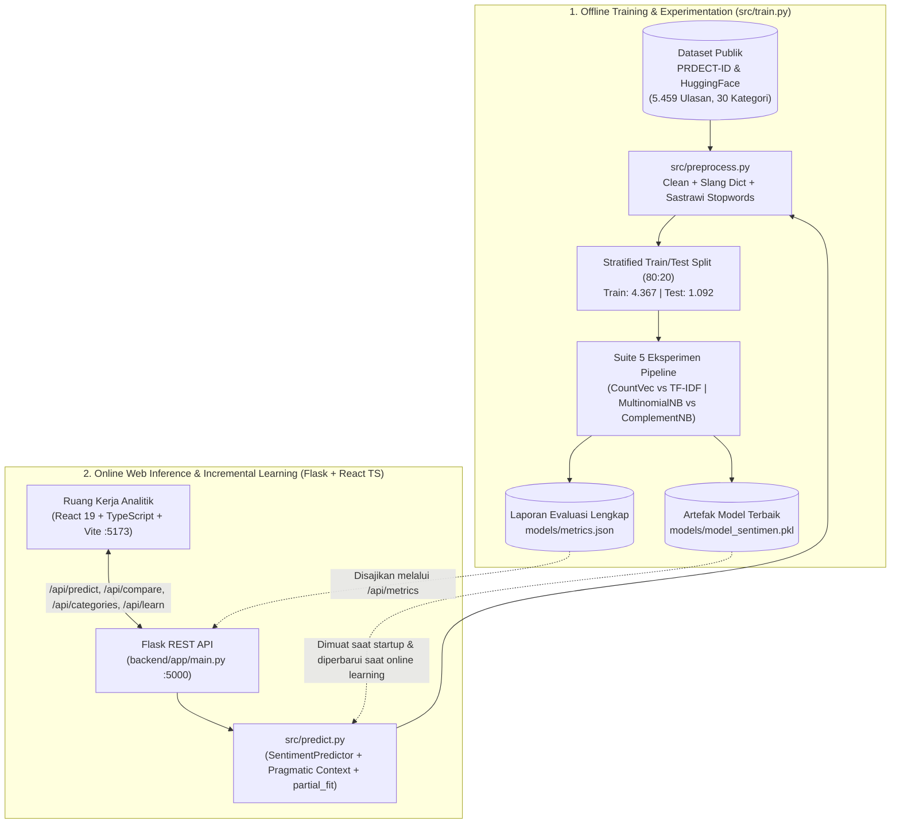

<div align="center">

# Klasifikasi Sentimen Ulasan Produk E-Commerce Indonesia
### End-to-End Indonesian NLP Pipeline, Online Learning (`partial_fit`), & Analytical Web Workspace

[](https://github.com/Muhfaizr21/Klasifikasi-sentimen-ulasan-produk/actions/workflows/ci.yml)
[](https://www.python.org/)
[](https://scikit-learn.org/)
[](https://flask.palletsprojects.com/)
[](https://react.dev/)
[](https://www.typescriptlang.org/)
[](https://www.docker.com/)

[Ringkasan Eksekutif](#ringkasan-eksekutif) •
[Kapabilitas Sistem](#kapabilitas-sistem) •
[Dataset & Pelabelan](#dataset-publik--aturan-pelabelan) •
[Arsitektur Sistem](#arsitektur-sistem) •
[Evaluasi & Eksperimen](#hasil-eksperimen--evaluasi-model) •
[Instalasi & Eksekusi](#instalasi--cara-menjalankan) •
[Referensi REST API](#spesifikasi-rest-api) •
[Pengujian Otomatis](#pengujian-otomatis-pytest)

</div>

---

## Ringkasan Eksekutif

Sistem ini mengimplementasikan pipeline **Natural Language Processing (NLP)** *end-to-end* untuk mengklasifikasikan ulasan pembeli e-commerce berbahasa Indonesia ke dalam tiga kelas sentimen: **Positif**, **Netral**, dan **Negatif**.

Dirancang dengan arsitektur *Single Source of Truth*, seluruh tahapan mulai dari akuisisi korpus publik (**PRDECT-ID Tokopedia** & **Hugging Face Indonesian E-Commerce**), pembersihan teks, normalisasi kosakata tidak baku (*slang*), *stopword removal* berbasis **PySastrawi** dengan preservasi kata negasi, penalaran pragmatik konteks kalimat, ekstraksi fitur **N-Gram (1, 2)**, hingga inferensi **Multinomial & Complement Naive Bayes** terintegrasi langsung dengan ruang kerja analitik berbasis **React 19 + TypeScript + Flask**.

---

## Kapabilitas Sistem

- **Analisis Sentimen Kontekstual & Explainability (`POST /api/predict`)**
  Menghasilkan prediksi kelas sentimen, distribusi probabilitas 3 kelas, waktu inferensi rata-rata 15-30 ms, rincian kontribusi *log-likelihood* Naive Bayes ($\log P(w|c)$) per token, serta deteksi nuansa pragmatik bahasa Indonesia (seperti pembalikan ekspektasi *"saya kira..."*, negasi langsung, dan negasi ganda).
- **Matriks Komparasi Reputasi 2 Produk (`POST /api/compare`)**
  Membandingkan dua produk e-commerce secara berdampingan (*split-ledger matrix*) mencakup indeks reputasi (`0-100`), distribusi sentimen agregat, sintesis aspek apresiasi utama (*pros*), catatan keluhan pembeli (*cons*), dan bukti kutipan ulasan terverifikasi.
- **Filter Dinamis 30 Kategori Korpus (`GET /api/categories`)**
  Membaca seluruh 30 subkategori produk dan 4 kelompok utama langsung dari korpus aktif beserta jumlah sampel secara *real-time* tanpa daftar kategori statis (*zero hardcode*), dilengkapi mode deteksi kategori otomatis dari kata kunci produk.
- **Tarikan Ulasan E-Commerce Live & Visual Katalog (`POST /api/realtime/fetch`)**
  Menarik umpan ulasan pelanggan dari platform e-commerce Indonesia (Tokopedia, Shopee, Lazada, Blibli, ZALORA, Sociolla, Eraspace, Ruparupa) maupun tautan produk langsung, lengkap dengan foto produk katalog dan kartu sintesis eksekutif (`ProductSummaryCard`).
- **Online Learning Inkremental (`POST /api/learn`)**
  Memungkinkan koreksi dan pelatihan ulang model secara instan di memori maupun di disk menggunakan `partial_fit` pada `MultinomialNB` tanpa harus melatih ulang dari awal.
- **Eksplorasi Bobot Leksikal & Word Cloud (`GET /api/top-words`)**
  Menampilkan kata kunci paling berpengaruh untuk masing-masing kelas sentimen berdasarkan selisih *log-likelihood* antar kelas.
- **Pemrosesan Batch CSV (`POST /api/predict/batch`) & Mode Cetak PDF**
  Mendukung unggah berkas CSV untuk klasifikasi massal beserta unduhan laporan hasil CSV dan tata letak cetak PDF standar akademik (`@media print`).

---

## Dataset Publik & Aturan Pelabelan

Proyek ini menggunakan gabungan dataset publik terverifikasi untuk ulasan e-commerce bahasa Indonesia dengan total **5.459 ulasan unik** yang mencakup **30 kategori produk**:

1. **PRDECT-ID (*Indonesian Product Reviews Dataset*) - Tokopedia**
   - **Sumber:** [rhiosutoyo/PRDECT-ID-Indonesian-Product-Reviews-Dataset](https://github.com/rhiosutoyo/PRDECT-ID-Indonesian-Product-Reviews-Dataset) / Mendeley Data (`DOI: 10.17632/574v66hf2v.1`).
   - **Cakupan:** Ulasan pembeli terverifikasi dari 29 kategori produk Tokopedia (Elektronik, Komputer & Laptop, Ponsel & Tablet, Kamera, Fashion Pria/Wanita/Muslim/Anak, Kecantikan, Perlengkapan Rumah, Dapur, Otomotif, Olahraga, Buku, Kesehatan, dll.).
2. **Hugging Face Indonesian E-Commerce Sentiment**
   - **Sumber:** [`AIbnuHibban/e-commerce-sentiment-bahasa-indonesia`](https://huggingface.co/datasets/AIbnuHibban/e-commerce-sentiment-bahasa-indonesia).
   - **Cakupan:** Digunakan untuk memperkaya representasi kalimat pada kelas minoritas (`netral`).

### Distribusi Kelas & Aturan Konversi Rating

| Kelas Sentimen | Aturan Konversi Rating | Jumlah Sampel | Persentase | Data Latih (80%) | Data Uji (20%) |
|:---------------|:----------------------:|:-------------:|:----------:|:----------------:|:--------------:|
| **Positif** | Bintang `4` & `5` | **2.517** | 46.11% | 2.014 | 503 |
| **Negatif** | Bintang `1` & `2` | **2.329** | 42.66% | 1.863 | 466 |
| **Netral** | Bintang `3` | **613** | 11.23% | 490 | 123 |
| **Total** | **Stratified Split (80:20)** | **5.459** | **100.0%** | **4.367** | **1.092** |

---

## Arsitektur Sistem

Sistem memisahkan **Offline Training Pipeline** dan **Online Web Inference**, namun mengikat keduanya pada modul `src/preprocess.py` dan `src/constants.py` yang sama sehingga tidak terjadi *feature skew* antara tahap pelatihan dan tahap produksi.



### Struktur Direktori Proyek

```text
Klasifikasi-sentimen-ulasan-produk/
├── .github/workflows/ci.yml             # Otomasi pengujian CI/CD (GitHub Actions)
├── Dockerfile                           # Multi-stage production container build
├── docker-compose.yml                   # Orkestrasi kontainer satu perintah
├── DESIGN.md                            # Spesifikasi sistem desain & tipografi antarmuka
├── ARSITEKTUR.md                        # Dokumentasi arsitektur teknis & aliran data
├── PRD.md                               # Product Requirements Document
├── README.md                            # Dokumentasi utama proyek
├── pytest.ini                           # Konfigurasi automated unit testing
├── requirements.txt                     # Dependensi Python terpusat
│
├── notebooks/
│   └── 01_eda_dan_visualisasi.ipynb     # Jupyter Notebook eksplorasi data & distribusi fitur
│
├── tests/
│   └── test_pipeline.py                 # 27 automated unit & integration test cases
│
├── scripts/
│   ├── generate_data.py                 # Pengunduh dataset publik PRDECT-ID & HuggingFace
│   └── dev.sh                           # Launcher server lokal terpadu (Flask + Vite)
│
├── src/                                 # Core ML & NLP Package (Single Source of Truth)
│   ├── __init__.py
│   ├── constants.py                     # Kamus normalisasi slang, path artefak, & penanda negasi
│   ├── preprocess.py                    # Pembersihan teks, normalisasi slang, & stopword Sastrawi
│   ├── train.py                         # Orkestrasi 5 eksperimen model & ekspor metrics.json
│   └── predict.py                       # Inference engine, pragmatic analyzer, synthesis, & partial_fit
│
├── models/
│   ├── model_sentimen.pkl               # Pipeline vectorizer + classifier terlatih
│   └── metrics.json                     # Laporan akurasi, Macro F1, & Confusion Matrix
│
├── backend/                             # Backend REST API Server (Flask)
│   ├── requirements.txt
│   └── app/
│       ├── __init__.py
│       └── main.py                      # Endpoint REST API, resolver produk e-commerce, & SPA server
│
└── frontend/                            # Frontend Analitik (React 19 + TypeScript + Vite)
    ├── package.json
    ├── vite.config.ts                   # Konfigurasi dev server & proxy API (:5173 -> :5000)
    └── src/
        ├── App.tsx                      # Ruang kerja utama, filter kategori dinamis, & live stream
        ├── index.css                    # Sistem token desain sesuai DESIGN.md
        ├── types/sentiment.ts           # Kontrak tipe data TypeScript
        ├── services/sentimentApi.ts     # Klien HTTP REST API
        └── components/
            ├── PredictionResultCard.tsx # Thread hasil analisis AI, jejak penalaran, & online learning
            ├── ProductSummaryCard.tsx   # Kartu sintesis eksekutif reputasi produk (pros/cons)
            ├── ProductComparisonView.tsx# Matriks komparasi berdampingan 2 produk (split ledger)
            ├── EvaluationDashboard.tsx  # Dashboard metrik akademik, Confusion Matrix, & Word Cloud
            ├── BatchUploadCard.tsx      # Modul klasifikasi massal CSV & unduh hasil
            ├── ProbabilityBar.tsx       # Visualisasi distribusi probabilitas kelas
            └── HistoryDrawer.tsx        # Penyimpanan riwayat analisis lokal
```

---

## Hasil Eksperimen & Evaluasi Model

Pengujian dilakukan terhadap **1.092 data uji** (*stratified split* 20%, `random_state=42`) dengan fitur **N-Gram `(1, 2)`** dan `max_features=2500`. Seluruh konfigurasi melampaui ambang batas evaluasi (`Macro F1 >= 0.70`):

| No | Konfigurasi Eksperimen | Vectorizer | Classifier | Stopword Removal | Accuracy | Macro F1 | Weighted F1 |
|:--:|:-----------------------|:-----------|:-----------|:----------------:|:--------:|:--------:|:-----------:|
| **1** | **CountVectorizer + MultinomialNB** *(Terbaik)* | `CountVectorizer` | `MultinomialNB` | **Ya (Sastrawi)** | **85.90%** | **77.28%** | **85.92%** |
| 2 | **TF-IDF + ComplementNB** | `TfidfVectorizer` | `ComplementNB` | Ya (Sastrawi) | 86.08% | 74.15% | 84.72% |
| 3 | **CountVectorizer + ComplementNB** | `CountVectorizer` | `ComplementNB` | Ya (Sastrawi) | 85.26% | 71.24% | 83.15% |
| 4 | **TF-IDF + MultinomialNB (Tanpa Stopwords)** | `TfidfVectorizer` | `MultinomialNB` | Tidak | 85.81% | 70.49% | 83.39% |
| 5 | **TF-IDF + MultinomialNB** | `TfidfVectorizer` | `MultinomialNB` | Ya (Sastrawi) | **86.17%** | 70.46% | 83.64% |

### Rincian Performa per Kelas (`CountVectorizer + MultinomialNB`)

| Kelas Sentimen | Precision | Recall | F1-Score | Support (Data Uji) |
|:---------------|:---------:|:------:|:--------:|:------------------:|
| **Positif** | **94.21%** | 90.66% | **92.40%** | 503 ulasan |
| **Negatif** | 86.21% | **89.91%** | **88.03%** | 466 ulasan |
| **Netral** *(Minoritas)* | 51.64% | 51.22% | **51.43%** | 123 ulasan |
| **Macro Average** | **77.36%** | **77.26%** | **77.28%** | **1.092 ulasan** |

### Confusion Matrix (Data Uji = 1.092 Ulasan)

| Aktual \ Prediksi | Prediksi: Positif | Prediksi: Netral | Prediksi: Negatif |
|:-----------------:|:-----------------:|:----------------:|:-----------------:|
| **Aktual: Positif** | **456** | 22 | 25 |
| **Aktual: Netral** | 18 | **63** | 42 |
| **Aktual: Negatif** | 10 | 37 | **419** |

---

## Instalasi & Cara Menjalankan

### Opsi A: Menggunakan Docker
```bash
git clone https://github.com/Muhfaizr21/Klasifikasi-sentimen-ulasan-produk.git
cd Klasifikasi-sentimen-ulasan-produk

docker compose up --build
```
Aplikasi langsung aktif di **`http://localhost:5000`**.

---

### Opsi B: Lingkungan Pengembangan Lokal (Flask + Vite)

#### 1. Persiapan Virtual Environment Python
```bash
python3 -m venv .venv
source .venv/bin/activate  # Windows: .venv\Scripts\activate
pip install --upgrade pip
pip install -r requirements.txt pytest
```

#### 2. Akuisisi Dataset Publik & Pelatihan Model
```bash
# Mengunduh korpus PRDECT-ID Tokopedia & HuggingFace
python scripts/generate_data.py

# Menjalankan 5 eksperimen pipeline & menyimpan model terbaik
python src/train.py
```

#### 3. Menjalankan Server Backend & Frontend
```bash
cd frontend
npm install
cd ..

# Menjalankan Flask (:5000) dan Vite (:5173) secara bersamaan
PYTHON_BIN="$(pwd)/.venv/bin/python" bash scripts/dev.sh
```
Buka ruang kerja analitik di **`http://localhost:5173`**.

---

## Spesifikasi REST API

| Method | Endpoint | Deskripsi |
|:------:|:---------|:----------|
| `POST` | `/api/predict` | Klasifikasi sentimen ulasan tunggal, atribusi kata kunci, analisis pragmatik, dan pencocokan media produk. |
| `POST` | `/api/predict/batch` | Klasifikasi sentimen massal melalui unggahan berkas CSV (`multipart/form-data`) atau payload JSON array. |
| `POST` | `/api/compare` | Komparasi reputasi *head-to-head* antara 2 produk e-commerce beserta sintesis kelebihan dan keluhan. |
| `GET` | `/api/categories` | Daftar dinamis 30 kategori dataset PRDECT-ID dan kelompok utama beserta jumlah sampel aktif. |
| `POST` | `/api/realtime/fetch` | Tarikan ulasan langsung dari platform e-commerce Indonesia atau URL produk beserta ringkasan eksekutif. |
| `POST` | `/api/learn` | Pelatihan inkremental secara *real-time* (`partial_fit`) untuk memperbarui bobot model Naive Bayes. |
| `GET` | `/api/top-words` | Daftar fitur leksikal teratas per kelas sentimen berdasarkan selisih *log-likelihood*. |
| `GET` | `/api/samples` | Pengambilan sampel ulasan dinamis dari korpus berdasarkan filter kategori atau kata kunci pencarian. |
| `GET` | `/api/metrics` | Laporan metrik evaluasi model, Confusion Matrix, dan hasil komparasi 5 eksperimen pipeline. |
| `GET` | `/api/health` | Pemeriksaan status kesiapan model dan total dokumen korpus aktif. |

### Contoh Permintaan `POST /api/predict`

**Request Body:**
```json
{
  "teks": "Barang original 100%, pengemasan rapi dan cepat sampai! Sangat puas.",
  "category": "Electronics"
}
```

**Response `200 OK`:**
```json
{
  "success": true,
  "label": "positif",
  "confidence": 99.98,
  "probabilitas": { "positif": 0.9998, "netral": 0.0002, "negatif": 0.0 },
  "explanation": [
    { "word": "rapi", "polarity": "positif", "score": 2.48 },
    { "word": "original", "polarity": "positif", "score": 1.38 },
    { "word": "cepat", "polarity": "positif", "score": 1.15 }
  ],
  "teks_bersih": "barang original pengemasan rapi cepat sangat puas"
}
```

---

## Pengujian Otomatis (Pytest)

Seluruh komponen mulai dari normalisasi teks, inferensi model, deteksi pragmatik, sintesis reputasi produk, online learning, filter kategori dinamis, hingga seluruh endpoint REST API diuji menggunakan **27 skenario pengujian otomatis**:

```bash
pytest -q
```
Output: `27 passed`.

---

## Dokumen Referensi

- [**Product Requirements Document (PRD.md)**](PRD.md): Spesifikasi kebutuhan fungsional dan target metrik evaluasi.
- [**Arsitektur Sistem (ARSITEKTUR.md)**](ARSITEKTUR.md): Rancangan modular pelatihan vs inferensi dan struktur komponen.
- [**Sistem Desain (DESIGN.md)**](DESIGN.md): Panduan palet warna, tipografi, dan tata letak antarmuka ruang kerja.

---

## Lisensi & Etika Penggunaan

Proyek ini dikembangkan untuk kepentingan akademik dan riset **Kecerdasan Buatan & Natural Language Processing Bahasa Indonesia**. Seluruh sampel ulasan berasal dari dataset publik yang telah dianonimkan dan bebas dari informasi identitas pribadi (*PII*).
