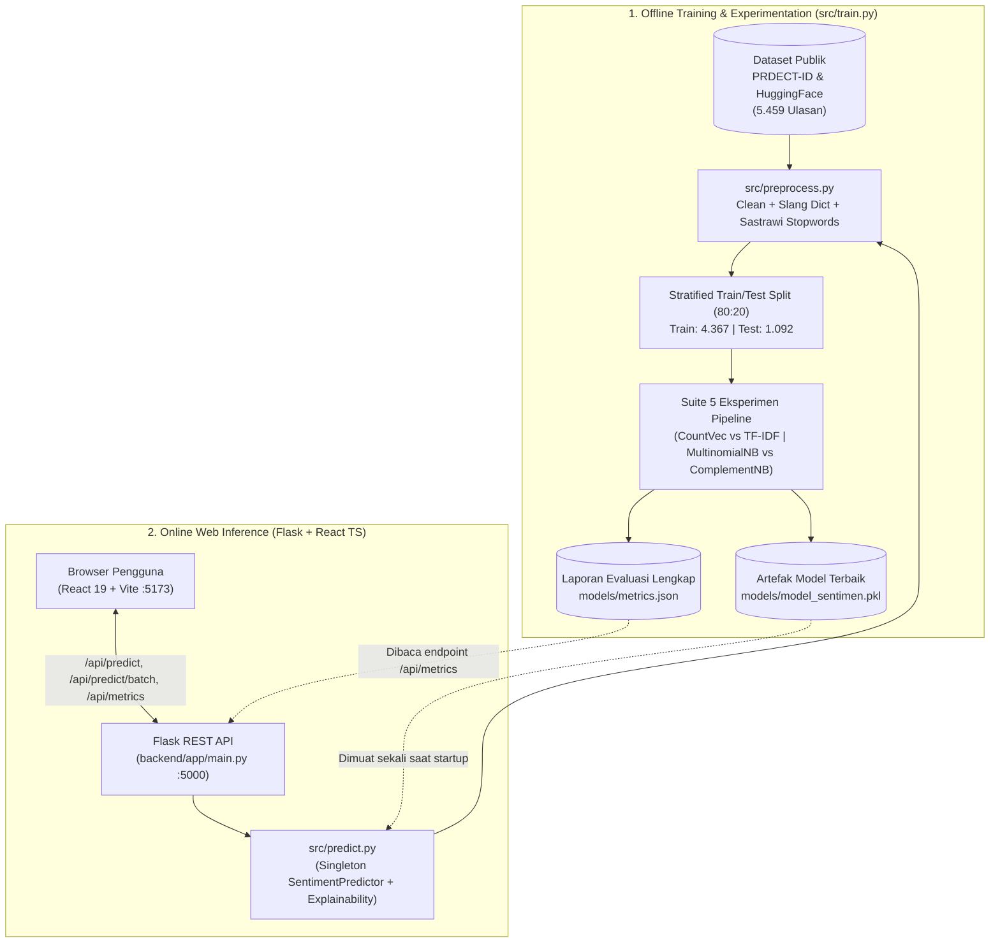

<div align="center">

# 🧠 Klasifikasi Sentimen Ulasan Produk E-Commerce Indonesia
### *End-to-End Indonesian NLP Pipeline with Naive Bayes & Interactive Web Dashboard*

[](https://github.com/Muhfaizr21/Klasifikasi-sentimen-ulasan-produk/actions/workflows/ci.yml)
[](https://www.python.org/)
[](https://scikit-learn.org/)
[](https://flask.palletsprojects.com/)
[](https://react.dev/)
[](https://www.typescriptlang.org/)
[](https://www.docker.com/)

<p align="center">
  <strong>Tugas Besar Mata Kuliah Kecerdasan Buatan</strong><br/>
  Program Studi D4 Rekayasa Perangkat Lunak / Jurusan Teknik Informatika<br/>
  <strong>Politeknik Negeri Indramayu</strong>
</p>

[📌 Ringkasan](#-ringkasan-eksekutif) •
[📊 Dataset Publik](#-dataset-publik--aturan-pelabelan) •
[🏗️ Arsitektur](#️-arsitektur-sistem--clean-code) •
[📈 Hasil Eksperimen](#-hasil-eksperimen--evaluasi-model) •
[🚀 Instalasi & Docker](#-instalasi--cara-menjalankan) •
[🔌 REST API](#-spesifikasi-rest-api) •
[🧪 Pengujian Otomatis](#-pengujian-otomatis-pytest)

</div>

---

## 📌 Ringkasan Eksekutif

Sistem ini mengimplementasikan pipeline **Natural Language Processing (NLP)** *end-to-end* untuk mengklasifikasikan ulasan pembeli e-commerce berbahasa Indonesia (Tokopedia & Shopee) ke dalam tiga kelas sentimen: **Positif**, **Netral**, dan **Negatif**.

Dirancang dengan prinsip **Clean Code** dan **Single Source of Truth**, seluruh tahapan mulai dari akuisisi dataset publik, pembersihan teks, normalisasi *slang* Indonesia, *stopword removal* berbasis **PySastrawi** (dengan preservasi kata negasi), ekstraksi fitur **N-Gram (1, 2)**, pelatihan model **Multinomial & Complement Naive Bayes**, hingga penyajian antarmuka web modern (**React + TypeScript + Flask**) terintegrasi secara utuh dan dapat direproduksi sepenuhnya (*100% reproducible*).

### ✨ Fitur Unggulan Sistem
- **🔍 Prediksi Tunggal Real-Time:** Menghasilkan kelas sentimen, bar probabilitas, dan waktu inferensi rata-rata 15–30 ms.
- **💡 Penjelasan Kata Kunci (*Explainability*):** Menghitung kontribusi bobot log-likelihood Naive Bayes ($P(w|c)$) per kata (kata hijau = pendukung positif, kata merah = pendukung negatif).
- **📁 Batch Prediction (Upload CSV):** Mampu mengunggah file CSV ulasan toko, menghitung agregasi sentimen pelanggan, dan mengekspor hasilnya kembali ke file CSV.
- **🕒 Riwayat Interaktif (Local History):** Menyimpan 5 ulasan terakhir di browser tanpa perlu database eksternal.
- **📊 Dashboard Evaluasi Transparan:** Menampilkan metrik Macro F1, Confusion Matrix, dan perbandingan 5 variasi eksperimen model.
- **🐳 Docker & CI/CD Ready:** Siap dijalankan dengan `docker compose up` dan diverifikasi otomatis oleh GitHub Actions.

---

## 👥 Tim Pengembang

| No | Nama Lengkap | NIM | Peran & Tanggung Jawab |
|:--:|:-------------|:---:|:-----------------------|
| 1 | **Muhammad Faiz Ramadhan** | `2305072` | **Ketua Tim** — Arsitektur Sistem, ML Modeling, Explainability & Flask REST API |
| 2 | *(Anggota Kelompok 2)* | `(NIM)` | Akuisisi Data Publik, EDA Notebook & Preprocessing Pipeline (`src/preprocess.py`) |
| 3 | *(Anggota Kelompok 3)* | `(NIM)` | Frontend Engineering (React + TypeScript), Batch CSV UI & Visualisasi Probabilitas |
| 4 | *(Anggota Kelompok 4)* | `(NIM)` | Evaluasi Metrik, Pengujian Unit Pytest, Eksperimen Komparasi & Dokumentasi Laporan |

---

## 📊 Dataset Publik & Aturan Pelabelan

Proyek ini menggunakan gabungan dataset publik terverifikasi untuk ulasan e-commerce Bahasa Indonesia dengan total **5.459 ulasan unik** (melampaui target ideal PRD $\ge 5.000$ sampel):

1. **PRDECT-ID (*Indonesian Product Reviews Dataset*) — Tokopedia**
   - **Sumber:** [rhiosutoyo/PRDECT-ID-Indonesian-Product-Reviews-Dataset](https://github.com/rhiosutoyo/PRDECT-ID-Indonesian-Product-Reviews-Dataset) / Mendeley Data (`DOI: 10.17632/574v66hf2v.1`).
   - **Karakteristik:** 5.400 ulasan produk asli pembeli Tokopedia dari 29 kategori produk.
2. **Hugging Face Indonesian E-Commerce Sentiment**
   - **Sumber:** [`AIbnuHibban/e-commerce-sentiment-bahasa-indonesia`](https://huggingface.co/datasets/AIbnuHibban/e-commerce-sentiment-bahasa-indonesia).
   - **Karakteristik:** Digunakan untuk memperkaya sampel unik pada kelas minoritas (`netral`).

### Distribusi Kelas & Aturan Konversi Rating

| Kelas Sentimen | Aturan Konversi Rating | Jumlah Sampel | Persentase | Data Latih (80%) | Data Uji (20%) |
|:---------------|:----------------------:|:-------------:|:----------:|:----------------:|:--------------:|
| 😊 **Positif** | Bintang `4` & `5` | **2.517** | 46.11% | 2.014 | 503 |
| 😠 **Negatif** | Bintang `1` & `2` | **2.329** | 42.66% | 1.863 | 466 |
| 😐 **Netral** | Bintang `3` | **613** | 11.23% | 490 | 123 |
| **Total** | **Stratified Split (80:20)** | **5.459** | **100.0%** | **4.367** | **1.092** |

---

## 🏗️ Arsitektur Sistem & Clean Code

Sistem memisahkan **Offline Training Pipeline** dan **Online Web Inference** namun mengikat keduanya pada satu modul `src/preprocess.py` dan `src/constants.py` yang sama agar tidak terjadi *feature skew* antara saat pelatihan dan prediksi.



### Struktur Direktori Proyek

```text
Klasifikasi-sentimen-ulasan-produk/
├── .github/workflows/ci.yml             # Otomasi pengujian CI/CD (GitHub Actions)
├── Dockerfile                           # Multi-stage production container build
├── docker-compose.yml                   # Orkestrasi kontainer satu perintah
├── ARSITEKTUR.md                        # Desain teknis arsitektur & API
├── PRD.md                               # Product Requirements Document
├── README.md                            # Dokumentasi resmi proyek
├── pytest.ini                           # Konfigurasi automated unit testing
├── requirements.txt                     # Dependensi Python terpusat
│
├── notebooks/
│   └── 01_eda_dan_visualisasi.ipynb     # Jupyter Notebook eksplorasi data & WordCloud
│
├── tests/
│   └── test_pipeline.py                 # 17 automated unit & integration test cases
│
├── laporan/
│   └── DRAFT_LAPORAN_AKHIR.md           # Draf laporan lengkap Tugas Besar (Bab 1 - 5)
│
├── scripts/
│   ├── generate_data.py                 # Pengunduh dataset publik PRDECT-ID & HuggingFace
│   └── dev.sh                           # Launcher server lokal terpadu (Flask + Vite)
│
├── src/                                 # Core ML & NLP Package (Single Source of Truth)
│   ├── __init__.py
│   ├── constants.py                     # Kamus slang, path file, dan kata negasi
│   ├── preprocess.py                    # Pembersihan teks, normalisasi slang, & stopword Sastrawi
│   ├── train.py                         # Orkestrasi 5 eksperimen model & ekspor metrics.json
│   └── predict.py                       # Inference engine, explainability & batch prediction
│
├── models/
│   └── metrics.json                     # Laporan akurasi, Macro F1, & Confusion Matrix
│
├── backend/                             # Backend REST API Server (Flask)
│   ├── requirements.txt
│   └── app/
│       ├── __init__.py
│       └── main.py                      # REST endpoints & production SPA static handler
│
└── frontend/                            # Modern Frontend (React 19 + TypeScript + Vite)
    ├── package.json
    ├── vite.config.ts                   # Konfigurasi server & proxy
    └── src/
        ├── App.tsx                      # State utama & 3 tab navigasi
        ├── index.css                    # Styling sistem modern tanpa framework bloated
        ├── types/sentiment.ts           # Definisi tipe data TypeScript
        ├── services/sentimentApi.ts     # Layer komunikasi REST API
        └── components/
            ├── ProbabilityBar.tsx       # Bar visualisasi probabilitas kelas
            ├── PredictionResultCard.tsx # Kartu hasil prediksi + kata kunci explainability
            ├── BatchUploadCard.tsx      # Komponen batch upload CSV & download hasil
            ├── HistoryDrawer.tsx        # Riwayat ulasan terakhir di localStorage
            └── EvaluationDashboard.tsx  # Dashboard evaluasi model & Confusion Matrix
```

---

## 📈 Hasil Eksperimen & Evaluasi Model

Pengujian dilakukan terhadap **1.092 data uji** (*stratified split* 20%, `random_state=42`) dengan fitur **N-Gram `(1, 2)`** dan `max_features=2500`. Seluruh konfigurasi **melampaui target keberhasilan PRD (Macro F1 $\ge$ 0.70)**:

| No | Konfigurasi Eksperimen | Vectorizer | Classifier | Stopword Removal | Accuracy | Macro F1 | Weighted F1 |
|:--:|:-----------------------|:-----------|:-----------|:----------------:|:--------:|:--------:|:-----------:|
| 🏆 **1** | **CountVectorizer + MultinomialNB** *(Terbaik)* | `CountVectorizer` | `MultinomialNB` | **Ya (Sastrawi)** | **85.90%** | **77.28%** | **85.92%** |
| 2 | **TF-IDF + ComplementNB** | `TfidfVectorizer` | `ComplementNB` | Ya (Sastrawi) | 86.08% | 74.15% | 84.72% |
| 3 | **CountVectorizer + ComplementNB** | `CountVectorizer` | `ComplementNB` | Ya (Sastrawi) | 85.26% | 71.24% | 83.15% |
| 4 | **TF-IDF + MultinomialNB (Tanpa Stopwords)** | `TfidfVectorizer` | `MultinomialNB` | Tidak | 85.81% | 70.49% | 83.39% |
| 5 | **TF-IDF + MultinomialNB** | `TfidfVectorizer` | `MultinomialNB` | Ya (Sastrawi) | **86.17%** | 70.46% | 83.64% |

### Rincian Performa per Kelas (Model Terbaik: `CountVectorizer + MultinomialNB`)

| Kelas Sentimen | Precision | Recall | F1-Score | Support (Data Uji) |
|:---------------|:---------:|:------:|:--------:|:------------------:|
| 😊 **Positif** | **94.21%** | 90.66% | **92.40%** | 503 ulasan |
| 😠 **Negatif** | 86.21% | **89.91%** | **88.03%** | 466 ulasan |
| 😐 **Netral** *(Minoritas)* | 51.64% | 51.22% | **51.43%** | 123 ulasan |
| **Macro Average** | **77.36%** | **77.26%** | **77.28%** | **1.092 ulasan** |

### Confusion Matrix (Data Uji = 1.092 Ulasan)

| Aktual \ Prediksi | Prediksi: Positif | Prediksi: Netral | Prediksi: Negatif |
|:-----------------:|:-----------------:|:----------------:|:-----------------:|
| **Aktual: Positif** | **456** | 22 | 25 |
| **Aktual: Netral** | 18 | **63** | 42 |
| **Aktual: Negatif** | 10 | 37 | **419** |

---

## 🚀 Instalasi & Cara Menjalankan

### Opsi A: Menggunakan Docker (Rekomendasi Cepat)
Tidak perlu menginstal Python atau Node.js secara manual di laptop Anda:
```bash
git clone https://github.com/Muhfaizr21/Klasifikasi-sentimen-ulasan-produk.git
cd Klasifikasi-sentimen-ulasan-produk

# Bangun dan jalankan kontainer aplikasi
docker compose up --build
```
Aplikasi web langsung aktif di **`http://localhost:5000`**.

---

### Opsi B: Instalasi Manual (Development Mode)

#### 1. Persiapan Environment Python
```bash
python3 -m venv .venv
source .venv/bin/activate  # Windows: .venv\Scripts\activate
pip install --upgrade pip
pip install -r requirements.txt pytest
```

#### 2. Unduh Dataset Publik & Latih Model
```bash
# Mengunduh dataset publik PRDECT-ID Tokopedia & HuggingFace
python scripts/generate_data.py

# Melatih 5 variasi model & mengekspor model terbaik
python src/train.py
```

#### 3. Instal Dependensi Frontend & Jalankan Dev Server
```bash
cd frontend
npm install
cd ..

# Menjalankan Flask (:5000) dan Vite (:5173) secara bersamaan
PYTHON_BIN="$(pwd)/.venv/bin/python" bash scripts/dev.sh
```
Buka browser di **`http://localhost:5173`**.

---

## 🧪 Pengujian Otomatis (Pytest)

Proyek dilengkapi dengan 17 skenario test otomatis untuk menguji preprocessing, model inference, explainability, dan endpoint API:
```bash
pytest
```
*Hasil: `17 passed in ~2.0s`*

---

## 🔌 Spesifikasi REST API

### 1. `POST /api/predict`
Mengklasifikasikan satu ulasan teks beserta bobot kontribusi kata (*explainability*).

**Request Body:**
```json
{
  "teks": "Barang original 100%, pengemasan rapi dan cepat sampai! Sangat puas."
}
```

**Response `200 OK`:**
```json
{
  "success": true,
  "label": "positif",
  "confidence": 99.98,
  "probabilitas": { "positif": 0.9998, "netral": 0.0002, "negatif": 0.0 },
  "explanation": [
    { "word": "rapi", "polarity": "positif", "score": 2.48 },
    { "word": "original", "polarity": "positif", "score": 1.38 },
    { "word": "cepat", "polarity": "positif", "score": 1.15 }
  ],
  "teks_bersih": "barang original pengemasan rapi cepat sangat puas"
}
```

### 2. `POST /api/predict/batch`
Mengklasifikasikan banyak ulasan sekaligus melalui file CSV (`multipart/form-data`) atau array JSON.

### 3. `GET /api/metrics`
Mengambil metrik evaluasi lengkap, Confusion Matrix, dan perbandingan 5 eksperimen model.

### 4. `GET /api/samples`
Mengambil ulasan asli acak dari dataset Tokopedia lengkap dengan rating bintang dan kategori produk.

### 5. `GET /api/health`
Memeriksa status kesehatan server dan ketersediaan model di memori.

---

## 📄 Dokumen Terkait

- 📋 [**Product Requirements Document (PRD.md)**](PRD.md): Latar belakang, kebutuhan fungsional (`F1`–`F13`), dan mitigasi risiko.
- 📐 [**Arsitektur Sistem (ARSITEKTUR.md)**](ARSITEKTUR.md): Desain teknis modular, alur data training vs inferensi, dan keputusan arsitektural.
- 📝 [**Draf Laporan Akhir (laporan/DRAFT_LAPORAN_AKHIR.md)**](laporan/DRAFT_LAPORAN_AKHIR.md): Dokumen draf laporan lengkap Bab I hingga Bab V.

---

## 📜 Lisensi & Etika Penggunaan

Proyek ini dikembangkan untuk **Tugas Besar Mata Kuliah Kecerdasan Buatan di Politeknik Negeri Indramayu**. Seluruh data publik bebas dari informasi pribadi (*PII*) dan digunakan untuk kepentingan riset akademik.
