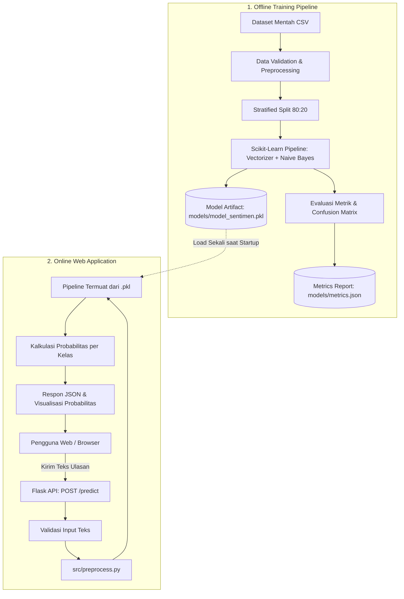

# Klasifikasi Sentimen Ulasan Produk (Naive Bayes)

[](https://www.python.org/)
[](https://flask.palletsprojects.com/)
[](https://scikit-learn.org/)
[](https://github.com/harisamp/pysastrawi)
[](#lisensi)

> **Tugas Besar Mata Kuliah Kecerdasan Buatan**  
> Program Studi D4 Rekayasa Perangkat Lunak / Teknik Informatika  
> **Politeknik Negeri Indramayu**

---

## 📌 Ringkasan Eksekutif

Proyek ini mengimplementasikan sistem *end-to-end* untuk klasifikasi sentimen ulasan produk marketplace (Tokopedia/Shopee) berbahasa Indonesia ke dalam 3 kelas: **Positif**, **Netral**, dan **Negatif**. 

Menggunakan pendekatan algoritma **Multinomial / Complement Naive Bayes** yang dipadukan dengan teknik representasi fitur **TF-IDF / Count Vectorizer** serta preprocessing spesifik bahasa Indonesia (normalisasi *slang*, pembersihan teks, dan stopword removal). Sistem dilengkapi antarmuka web interaktif berbasis **Flask** untuk pengujian inferensi *real-time* (< 2 detik) dan visualisasi evaluasi model.

---

## 👥 Tim Pengembang

| No | Foto / Inisial | Nama Lengkap | NIM | Peran Utama |
|:--:|:--------------:|:-------------|:---:|:------------|
| 1  | 👨‍💻 | **Muhammad Faiz Ramadhan** | `2305072` | **Ketua Tim**, ML Modeling & Backend Engineering |
| 2  | 📊 | *(Nama Anggota 2)* | `(NIM)` | Data Acquisition & Preprocessing Pipeline |
| 3  | 🎨 | *(Nama Anggota 3)* | `(NIM)` | Frontend UI/UX & Web Demo Integration |
| 4  | 📝 | *(Nama Anggota 4)* | `(NIM)` | Model Evaluation, Documentation & Reporting |

---

## 🚀 Fitur Utama

- **End-to-End NLP Pipeline:** Integrasi konsisten preprocessing, ekstraksi fitur, dan inferensi menggunakan Scikit-Learn `Pipeline`.
- **Indonesian Slang Normalization:** Pembersihan tanda baca, angka, URL, karakter non-alfanumerik, dan konversi kata gaul/informal ke bentuk baku.
- **Prediksi Real-time Berbasis Probabilitas:** Menampilkan label sentimen dominan sekaligus rincian bar probabilitas keyakinan model (`predict_proba`) per kelas dalam waktu < 2 detik.
- **Model Comparison & Experimentation:** Mendukung komparasi antara `CountVectorizer` vs `TfidfVectorizer`, serta `MultinomialNB` vs `ComplementNB` (efektif mengatasi *class imbalance*).
- **Interactive Evaluation Dashboard:** Halaman evaluasi terdedikasi untuk inspeksi metrik performa (*Macro F1*, *Precision*, *Recall*, dan *Confusion Matrix*).

---

## 🏗️ Arsitektur Sistem & Alur Kerja



> **Prinsip Desain:** Modul [`src/preprocess.py`](src/preprocess.py) digunakan bersama oleh tahap pelatihan ([`src/train.py`](src/train.py)) dan inferensi web ([`src/predict.py`](src/predict.py)) untuk mencegah ketidakcocokan fitur (*feature leakage/skew*).

---

## 📂 Struktur Proyek

```text
Klasifikasi-sentimen-ulasan-produk/
├── ARSITEKTUR.md           # Desain teknis, komponen arsitektur, dan spesifikasi API
├── PRD.md                  # Product Requirement Document dan metrik keberhasilan
├── README.md               # Dokumentasi utama proyek
├── requirements.txt        # Daftar pustaka & dependensi Python
│
├── data/
│   ├── raw/                # Dataset ulasan mentah (.csv)
│   └── processed/          # Data hasil pembersihan dan split
│
├── notebooks/
│   └── 01_eda_dan_eksperimen.ipynb   # Eksplorasi data awal (EDA) & perbandingan model
│
├── src/
│   ├── __init__.py
│   ├── preprocess.py       # Modul preprocessing & normalisasi kata slang
│   ├── train.py            # Script pelatihan, validasi silang, dan export model
│   └── predict.py          # Wrapper inferensi model untuk backend
│
├── app/
│   ├── main.py             # Server Flask (routing halaman & endpoint API)
│   ├── templates/
│   │   ├── index.html      # Halaman form ulasan & hasil inferensi
│   │   └── evaluasi.html   # Halaman dashboard metrik & confusion matrix
│   └── static/
│       ├── css/style.css   # Styling antarmuka
│       └── js/main.js      # Fetch handler asinkron & render probabilitas
│
├── models/
│   ├── model_sentimen.pkl  # Objek pipeline Scikit-Learn tersimpan
│   └── metrics.json        # Skor performa (Macro F1, Precision, Recall)
│
└── laporan/                # Draft laporan akhir dan berkas presentasi
```

---

## 🛠️ Instalasi & Cara Menjalankan

### Prasyarat Sistem
- **Python:** Versi 3.10 atau lebih baru
- **Git**

### 1. Kloning Repositori
```bash
git clone https://github.com/Muhfaizr21/Klasifikasi-sentimen-ulasan-produk.git
cd Klasifikasi-sentimen-ulasan-produk
```

### 2. Konfigurasi Virtual Environment
Gunakan virtual environment agar dependensi terisolasi:

- **Linux / macOS:**
  ```bash
  python3 -m venv .venv
  source .venv/bin/activate
  ```
- **Windows:**
  ```cmd
  python -m venv .venv
  .venv\Scripts\activate
  ```

### 3. Instal Dependensi
```bash
pip install --upgrade pip
pip install -r requirements.txt
```

### 4. Pelatihan Model (*Training*)
Jalankan proses pelatihan untuk menghasilkan berkas artefak model di direktori `models/`:
```bash
python src/train.py
```
> Tahap ini akan memproses dataset, melatih model Naive Bayes, lalu membuat file `models/model_sentimen.pkl` dan `models/metrics.json`.

### 5. Jalankan Web Demo
Jalankan aplikasi backend Flask:
```bash
python app/main.py
```
Akses antarmuka web melalui browser di:  
👉 **`http://127.0.0.1:5000`**

---

## 🔌 Dokumentasi REST API

### Prediksi Sentimen
Melakukan analisis sentimen terhadap sebuah teks ulasan.

- **URL:** `/predict`
- **Method:** `POST`
- **Content-Type:** `application/json`

#### Request Body
```json
{
  "teks": "Barang original, pengemasan rapi dan cepat sampai! Sangat puas belanja disini."
}
```

#### Response Success (200 OK)
```json
{
  "label": "positif",
  "probabilitas": {
    "positif": 0.9412,
    "netral": 0.0431,
    "negatif": 0.0157
  },
  "teks_bersih": "barang original kemas rapi cepat sampai puas belanja"
}
```

#### Response Errors
- `400 Bad Request`: Input teks kosong, tipe data tidak valid, atau panjang melebihi 1.000 karakter.
- `500 Internal Server Error`: Berkas model gagal dimuat atau belum dilatih.

---

## 📊 Target & Evaluasi Model

| Metrik Evaluasi | Target Capaian | Deskripsi Target |
|:----------------|:--------------:|:-----------------|
| **Macro F1-Score** | **≥ 0.70** | Mengukur performa rata-rata harmonis ketiga kelas secara adil |
| **Waktu Inferensi** | **< 2.0 Detik** | Latensi respons prediksi pada pengujian laptop standar |
| **Recall (Kelas Netral)** | Dilaporkan | Analisis khusus evaluasi kelas minoritas / batas ambigu |

> *Hasil evaluasi aktual dari setiap varian eksperimen (TF-IDF vs CountVectorizer, MultinomialNB vs ComplementNB) dapat ditinjau langsung di halaman `/evaluasi` web demo.*

---

## ⚠️ Batasan Sistem & Mitigasi

1. **Struktur Tata Bahasa & Negasi:** Asumsi independensi fitur pada Naive Bayes mengabaikan urutan kata, sehingga kalimat negasi seperti *"tidak mengecewakan"* berpotensi salah diidentifikasi sebagai negatif. Mitigasi: Eksperimen n-gram (`ngram_range=(1, 2)`).
2. **Keterbatasan Kosakata (*Out of Vocabulary*):** Kata-kata yang tidak muncul pada fase pelatihan akan diabaikan.
3. **Cakupan Bahasa:** Model dioptimalkan khusus untuk Bahasa Indonesia. Campuran bahasa gaul daerah atau istilah asing dapat memengaruhi tingkat akurasi prediksi.
4. **Sarkasme:** Sentimen yang mengandung ironi/sarkasme merupakan limitasi alami dari model berbasis *bag-of-words*.

---

## 📄 Dokumen Terkait

- 📋 [**Product Requirements Document (PRD)**](PRD.md): Latar belakang masalah, ruang lingkup, kebutuhan fungsional & non-fungsional, dan mitigasi risiko.
- 📐 [**Arsitektur Sistem (ARSITEKTUR.md)**](ARSITEKTUR.md): Desain teknis modular, alur data training vs inferensi, spesifikasi endpoint, dan keputusan arsitektural.

---

## 📜 Lisensi & Etika Data

Proyek ini dikembangkan semata-mata untuk **keperluan akademis Tugas Besar Mata Kuliah Kecerdasan Buatan Politeknik Negeri Indramayu**. Dataset yang digunakan dibersihkan dari informasi sensitif/pribadi (PII) dan tidak merepresentasikan opini resmi terkait entitas komersial tertentu.
