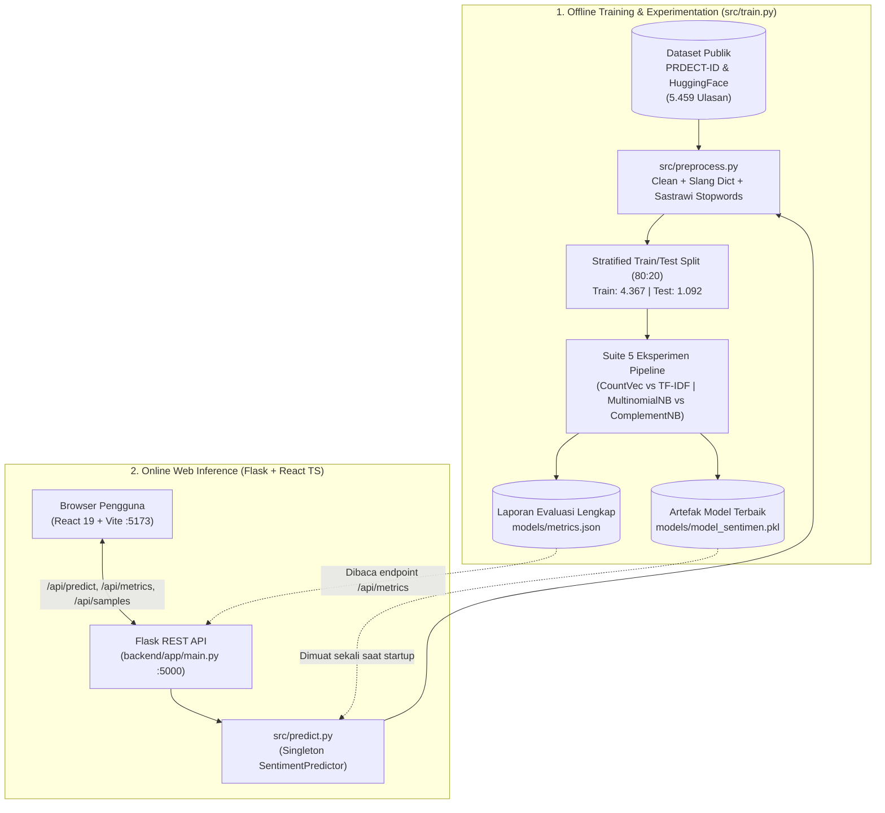

<div align="center">

# 🧠 Klasifikasi Sentimen Ulasan Produk E-Commerce Indonesia
### *End-to-End Indonesian NLP Pipeline with Naive Bayes & Interactive Web Dashboard*

[](https://www.python.org/)
[](https://scikit-learn.org/)
[](https://flask.palletsprojects.com/)
[](https://react.dev/)
[](https://www.typescriptlang.org/)
[](https://vite.dev/)

<p align="center">
  <strong>Tugas Besar Mata Kuliah Kecerdasan Buatan</strong><br/>
  Program Studi D4 Rekayasa Perangkat Lunak / Jurusan Teknik Informatika<br/>
  <strong>Politeknik Negeri Indramayu</strong>
</p>

[📌 Ringkasan](#-ringkasan-eksekutif) •
[📊 Dataset Publik](#-dataset-publik--aturan-pelabelan) •
[🏗️ Arsitektur](#️-arsitektur-sistem--clean-code) •
[📈 Hasil Eksperimen](#-hasil-eksperimen--evaluasi-model) •
[🚀 Instalasi](#-instalasi--cara-menjalankan) •
[🔌 REST API](#-spesifikasi-rest-api)

</div>

---

## 📌 Ringkasan Eksekutif

Sistem ini mengimplementasikan pipeline **Natural Language Processing (NLP)** *end-to-end* untuk mengklasifikasikan ulasan pembeli e-commerce berbahasa Indonesia (Tokopedia & Shopee) ke dalam tiga kelas sentimen: **Positif**, **Netral**, dan **Negatif**.

Dirancang dengan prinsip **Clean Code** dan **Single Source of Truth**, seluruh tahapan mulai dari akuisisi dataset publik, pembersihan teks, normalisasi *slang* Indonesia, *stopword removal* berbasis **PySastrawi** (dengan preservasi kata negasi), ekstraksi fitur **N-Gram (1, 2)**, pelatihan model **Multinomial & Complement Naive Bayes**, hingga penyajian antarmuka web modern (**React + TypeScript + Flask**) terintegrasi secara utuh dan dapat direproduksi sepenuhnya (*100% reproducible*).

---

## 👥 Tim Pengembang

| No | Nama Lengkap | NIM | Peran & Tanggung Jawab |
|:--:|:-------------|:---:|:-----------------------|
| 1 | **Muhammad Faiz Ramadhan** | `2305072` | **Ketua Tim** — Arsitektur Sistem, ML Modeling & Flask REST API |
| 2 | *(Anggota Kelompok 2)* | `(NIM)` | Akuisisi Data Publik, EDA & Preprocessing Pipeline (`src/preprocess.py`) |
| 3 | *(Anggota Kelompok 3)* | `(NIM)` | Frontend Engineering (React + TypeScript) & Integrasi UI/UX |
| 4 | *(Anggota Kelompok 4)* | `(NIM)` | Evaluasi Metrik, Eksperimen Komparasi & Dokumentasi Laporan |

---

## 📊 Dataset Publik & Aturan Pelabelan

Proyek ini menggunakan gabungan dataset publik terverifikasi untuk ulasan e-commerce Bahasa Indonesia dengan total **5.459 ulasan unik** (melampaui target ideal PRD $\ge 5.000$ sampel):

1. **PRDECT-ID (*Indonesian Product Reviews Dataset*) — Tokopedia**
   - **Sumber:** [rhiosutoyo/PRDECT-ID-Indonesian-Product-Reviews-Dataset](https://github.com/rhiosutoyo/PRDECT-ID-Indonesian-Product-Reviews-Dataset) / Mendeley Data (`DOI: 10.17632/574v66hf2v.1`).
   - **Karakteristik:** 5.400 ulasan produk asli pembeli Tokopedia dari 29 kategori produk.
2. **Hugging Face Indonesian E-Commerce Sentiment**
   - **Sumber:** [`AIbnuHibban/e-commerce-sentiment-bahasa-indonesia`](https://huggingface.co/datasets/AIbnuHibban/e-commerce-sentiment-bahasa-indonesia).
   - **Karakteristik:** Digunakan untuk memperkaya sampel unik pada kelas minoritas (`netral`).

### Distribusi Kelas & Aturan Konversi Rating

| Kelas Sentimen | Aturan Konversi Rating | Jumlah Sampel | Persentase |Data Latih (80%) | Data Uji (20%) |
|:---------------|:----------------------:|:-------------:|:----------:|:---------------:|:--------------:|
| 😊 **Positif** | Bintang `4` & `5` | **2.517** | 46.11% | 2.014 | 503 |
| 😠 **Negatif** | Bintang `1` & `2` | **2.329** | 42.66% | 1.863 | 466 |
| 😐 **Netral** | Bintang `3` | **613** | 11.23% | 490 | 123 |
| **Total** | **Stratified Split (80:20)** | **5.459** | **100.0%** | **4.367** | **1.092** |

---

## 🏗️ Arsitektur Sistem & Clean Code

Sistem memisahkan **Offline Training Pipeline** dan **Online Web Inference** namun mengikat keduanya pada satu modul `src/preprocess.py` dan `src/constants.py` yang sama agar tidak terjadi *feature skew* antara saat pelatihan dan prediksi.



### Struktur Direktori (Clean Architecture)

```text
Klasifikasi-sentimen-ulasan-produk/
├── ARSITEKTUR.md                        # Spesifikasi desain teknis & keputusan arsitektur
├── PRD.md                               # Product Requirements Document (Fungsional & Non-Fungsional)
├── README.md                            # Dokumentasi utama repositori
├── requirements.txt                     # Dependensi Python terpusat
│
├── scripts/
│   ├── generate_data.py                 # Pengunduh otomatis dataset publik PRDECT-ID & HuggingFace
│   └── dev.sh                           # Launcher terpadu (menjalankan Flask + Vite sekaligus)
│
├── src/                                 # Core Machine Learning & NLP Package (Single Source of Truth)
│   ├── __init__.py
│   ├── constants.py                     # Konfigurasi path, kamus slang Indonesia, & kata negasi
│   ├── preprocess.py                    # Pembersihan teks, normalisasi slang, & Sastrawi stopword
│   ├── train.py                         # Orkestrasi 5 eksperimen model & ekspor metrics.json
│   └── predict.py                       # Singleton predictor service untuk CLI & Web API
│
├── models/                              # Artefak hasil pelatihan
│   └── metrics.json                     # Hasil akurasi, Macro F1, & Confusion Matrix 5 eksperimen
│
├── backend/                             # Backend REST API Server
│   ├── requirements.txt
│   └── app/
│       ├── __init__.py
│       └── main.py                      # Controller endpoint (/api/predict, /api/metrics, /api/samples)
│
└── frontend/                            # Modern Frontend Application (React 19 + TypeScript + Vite)
    ├── package.json
    ├── vite.config.ts                   # Konfigurasi Vite dev server & reverse proxy ke Flask
    └── src/
        ├── App.tsx                      # State halaman utama & navigasi tab
        ├── index.css                    # Desain sistem CSS modern & responsif
        ├── types/
        │   └── sentiment.ts             # Kontrak tipe data TypeScript
        ├── services/
        │   └── sentimentApi.ts          # Layer klien HTTP REST API
        └── components/
            ├── ProbabilityBar.tsx       # Visualisasi bar probabilitas kelas
            ├── PredictionResultCard.tsx # Kartu hasil prediksi & inspeksi preprocessing
            └── EvaluationDashboard.tsx  # Dashboard KPI, Confusion Matrix, & tabel eksperimen
```

---

## 📈 Hasil Eksperimen & Evaluasi Model

Pengujian dilakukan terhadap **1.092 data uji** (*stratified split* 20%, `random_state=42`) dengan fitur **N-Gram `(1, 2)`** dan `max_features=2500`. Seluruh konfigurasi **melampaui target keberhasilan PRD (Macro F1 $\ge$ 0.70)**:

| No | Konfigurasi Eksperimen | Vectorizer | Classifier | Stopword Removal | Accuracy | Macro F1 | Weighted F1 |
|:--:|:-----------------------|:-----------|:-----------|:----------------:|:--------:|:--------:|:-----------:|
| 🏆 **1** | **CountVectorizer + MultinomialNB** *(Terbaik)* | `CountVectorizer` | `MultinomialNB` | **Ya (Sastrawi)** | **85.90%** | **77.28%** | **85.92%** |
| 2 | **TF-IDF + ComplementNB** | `TfidfVectorizer` | `ComplementNB` | Ya (Sastrawi) | 86.08% | 74.15% | 84.72% |
| 3 | **CountVectorizer + ComplementNB** | `CountVectorizer` | `ComplementNB` | Ya (Sastrawi) | 85.26% | 71.24% | 83.15% |
| 4 | **TF-IDF + MultinomialNB (Tanpa Stopwords)** | `TfidfVectorizer` | `MultinomialNB` | Tidak | 85.81% | 70.49% | 83.39% |
| 5 | **TF-IDF + MultinomialNB** | `TfidfVectorizer` | `MultinomialNB` | Ya (Sastrawi) | **86.17%** | 70.46% | 83.64% |

### Rincian Performa per Kelas (Model Terbaik: `CountVectorizer + MultinomialNB`)

| Kelas Sentimen | Precision | Recall | F1-Score | Support (Data Uji) |
|:---------------|:---------:|:------:|:--------:|:------------------:|
| 😊 **Positif** | **94.21%** | 90.66% | **92.40%** | 503 ulasan |
| 😠 **Negatif** | 86.21% | **89.91%** | **88.03%** | 466 ulasan |
| 😐 **Netral** *(Minoritas)* | 51.64% | 51.22% | **51.43%** | 123 ulasan |
| **Macro Average** | **77.36%** | **77.26%** | **77.28%** | **1.092 ulasan** |

### Confusion Matrix (Data Uji = 1.092 Ulasan)

| Aktual \ Prediksi | Prediksi: Positif | Prediksi: Netral | Prediksi: Negatif |
|:-----------------:|:-----------------:|:----------------:|:-----------------:|
| **Aktual: Positif** | **456** | 22 | 25 |
| **Aktual: Netral** | 18 | **63** | 42 |
| **Aktual: Negatif** | 10 | 37 | **419** |

> **Temuan Analisis:**
> 1. **Preservasi Kata Negasi:** Secara bawaan, daftar stopword Sastrawi menghapus kata `"tidak"`, yang menyebabkan frasa *"tidak bagus"* terprediksi positif. Dengan memfilter kata negasi (`PRESERVED_SENTIMENT_WORDS` di `src/constants.py`) dan menggunakan `ngram_range=(1, 2)`, bigram seperti `"tidak bagus"` dan `"tidak sesuai"` berhasil ditangkap dengan baik.
> 2. **Tantangan Kelas Netral:** Pada ulasan bintang 3 di Tokopedia, pembeli sering menulis keluhan bercampur pujian (misal *"barang bagus tapi pengiriman lama"*), sehingga kelas `netral` memiliki distribusi kosakata yang beririsan dengan kelas `positif` dan `negatif`. Penggunaan `CountVectorizer + MultinomialNB` memberikan *Recall* kelas netral tertinggi (**51.22%**) dibanding `TF-IDF + MultinomialNB` (**18.70%**).

---

## 🚀 Instalasi & Cara Menjalankan

### Prasyarat
- **Python** `3.10+`
- **Node.js** `18+` & **npm**

### 1. Clone Repositori
```bash
git clone https://github.com/Muhfaizr21/Klasifikasi-sentimen-ulasan-produk.git
cd Klasifikasi-sentimen-ulasan-produk
```

### 2. Siapkan Environment Python & Dependensi
```bash
python3 -m venv .venv
source .venv/bin/activate  # Windows: .venv\Scripts\activate
pip install --upgrade pip
pip install -r requirements.txt
```

### 3. Unduh Dataset Publik & Latih Model
```bash
# Mengunduh dataset asli PRDECT-ID (Tokopedia) & HuggingFace ke folder data/
python scripts/generate_data.py

# Menjalankan 5 eksperimen pelatihan & menyimpan model terbaik ke folder models/
python src/train.py
```

### 4. Instal Dependensi Frontend & Jalankan Server Terpadu
```bash
cd frontend
npm install
cd ..

# Menjalankan Backend Flask (http://127.0.0.1:5000) & Frontend Vite (http://localhost:5173)
PYTHON_BIN="$(pwd)/.venv/bin/python" bash scripts/dev.sh
```
Buka browser di **`http://localhost:5173`**.

---

## 🔌 Spesifikasi REST API

Backend Flask berjalan di `http://127.0.0.1:5000` dan di-*proxy* secara otomatis oleh Vite pada `/api/*`.

### 1. `POST /api/predict` (atau `POST /predict`)
Mengklasifikasikan sentimen satu teks ulasan produk (maksimal 1.000 karakter).

**Request Body:**
```json
{
  "teks": "Brg ori 100%, paking rapi dan pengiriman cepet bgt! Sangat puas belanja disini."
}
```

**Response `200 OK`:**
```json
{
  "success": true,
  "label": "positif",
  "confidence": 99.98,
  "probabilitas": {
    "positif": 0.9998,
    "netral": 0.0002,
    "negatif": 0.0
  },
  "probabilities": {
    "positif": 99.98,
    "netral": 0.02,
    "negatif": 0.0
  },
  "teks_bersih": "barang original pengemasan rapi pengiriman cepat sangat sangat puas belanja disini",
  "text": "Brg ori 100%, paking rapi dan pengiriman cepet bgt! Sangat puas belanja disini.",
  "timestamp": "2026-11-13T20:15:00.000000+00:00"
}
```

### 2. `GET /api/metrics` (atau `GET /evaluasi`)
Mengambil laporan metrik evaluasi lengkap (`Accuracy`, `Macro F1`, `Classification Report`, `Confusion Matrix`, dan tabel 5 eksperimen) dari `models/metrics.json`.

### 3. `GET /api/samples`
Mengambil sampel ulasan asli acak per kelas sentimen (`positif`, `netral`, `negatif`) langsung dari dataset Tokopedia untuk fitur uji cepat di halaman web.

### 4. `GET /api/health`
Memeriksa status kesehatan server dan kesiapan model di memori (`models_loaded: true`).

---

## 📄 Dokumentasi Terkait

- 📋 [**Product Requirements Document (PRD.md)**](PRD.md): Latar belakang, ruang lingkup, kebutuhan fungsional (`F1`–`F13`), target metrik, dan mitigasi risiko.
- 📐 [**Arsitektur Sistem (ARSITEKTUR.md)**](ARSITEKTUR.md): Diagram alur pelatihan & prediksi, spesifikasi komponen, serta keputusan desain.

---

## 📜 Lisensi & Etika Penggunaan

Proyek ini dikembangkan untuk memenuhi **Tugas Besar Mata Kuliah Kecerdasan Buatan di Politeknik Negeri Indramayu**. Seluruh data ulasan publik telah dibersihkan dari informasi identitas pribadi (*Personally Identifiable Information*) dan digunakan murni untuk tujuan riset akademik.
